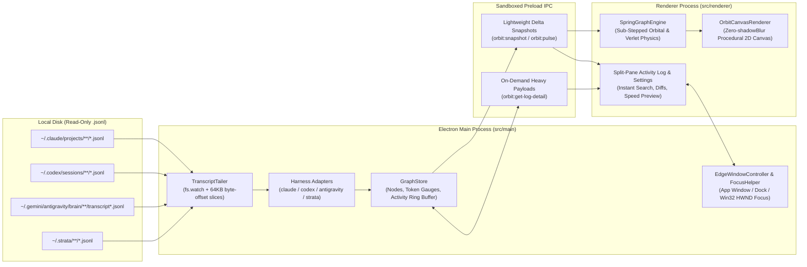

# Agent Orbit

A passive, **zero-context-overhead** 2D cosmic visualizer and live activity monitor for coding agents (**Claude Code**, **Codex**, **Antigravity**, and **Strata**).


Agent Orbit watches append-only `.jsonl` session transcripts directly on disk and renders every active session as a living solar system — complete with stellar evolution, orbiting subagent exoplanets, solar accretion flares, turn-scaled Kuiper asteroid belts, context-window fuel rings, and an expandable real-time activity log.

---

## Highlights

- **Zero Token / Context Overhead:** Passively tails local session files (`~/.claude/projects`, `~/.codex/sessions`, `~/.gemini/antigravity/brain`, `~/.strata`) via incremental byte offsets. Never injects prompts, MCP servers, or hooks into your agents.
- **Dual Window Modes (`App Window` & `Screen-Edge Dock`):**
  - **App Window:** Resizable, snap-friendly desktop window with split-pane cosmic canvas + live trailing activity log.
  - **Screen-Edge Dock:** Collapses to a scrollbar-safe 26×196px capsule on any monitor edge (`Left`, `Right`, `Top`, `Bottom`) with Win32 region clipping (`SetWindowRgn`) so IDE/browser scrollbars stay completely unobstructed.
- **Living Stellar Systems:**
  - **Orchestrator Stars:** Evolve through 5 astrophysical spectral classes (`Protostar` → `Main Sequence` → `Subgiant` → `Giant` → `Supergiant`) as sessions spawn subagents and accumulate work, with harness-tinted coronas, segmented tool-category arcs, expressive eyes (`zzZ` when idle), and **Core Fuel** context-window gauges (`200k` / `258k` / `400k` / `1M+` auto-detected per model).
  - **Subagent Exoplanets:** Active subagents orbit on Keplerian rings as procedural rocky, ocean, ringed, terrestrial, ice, and volcanic exoplanets with orbiting tool-probe satellites and live tether telemetry packets.
  - **Solar Accretion Flares & Turn-Scaled Kuiper Belts:** When a live subagent completes, it returns an energy packet to its parent star (triggering a solar prominence flare) and spirals gracefully into a spaced outer Kuiper belt, where each asteroid's mass and craggy silhouette scale with how many model turns that subagent executed.
  - **Skill Moons:** Invoked skills (`Skill` tool, `/slash` commands, or `SKILL.md` reads) attach as orbiting moons.
- **Granular Trailing Activity Log:**
  - Semantic task badges (`PROMPT`, `REPLY`, `PLAN`, `EDIT`, `WRITE`, `READ`, `SEARCH`, `GIT`, `TEST`, `BUILD`, `PR`, `MCP`, `ASK`, `SPAWN`, `DONE`) with instant multi-token search (`/` or `Ctrl+F`).
  - Click any row to lazy-load full untruncated prompts, replies, structured tool-call JSON arguments, unified `- / +` diffs, and terminal output.
  - Click file paths or `PR` links to open them safely, or click an agent chip to pan & zoom directly to that star or exoplanet on the canvas.
- **Waiting-on-You Spotlight & Global Hotkeys:**
  - Detects blocked orchestrators (`AskUserQuestion`, `ask_question`, `request_user_input`, plan reviews, completed turns), elevates them into a dedicated top **Awaiting You** spotlight lane, and surfaces a one-click jump pill + `Alt+Shift+Space` global shortcut.
  - Double-click any star (or click **Jump to Window**) to bring the matching IDE or terminal window to the foreground on Windows.
- **Dedicated Settings Window (`⚙` or `Ctrl+,`):**
  - Customize **Animation Speed** (`0.1×` contemplative drift to `3.0×` lively, with a live miniature star-system preview), default **Time Horizon**, and **Display Mode**.


---

## Quick Start

### Prerequisites

- **Windows 10 / 11** *(uses native `.NET Framework csc.exe` helpers for Win32 window focus, region clipping, and optional Desktop `.exe` launcher; core Electron visualizer + test suite also run from source on macOS and Linux)*
- **Node.js 20+** and `npm`

### Install & Run from Source

```bash
git clone https://github.com/LGTM-Probably/agent-orbit.git
cd agent-orbit
npm install
npm start
```

> **Note on Prebuilt Windows `.exe` Releases:** Community release builds are not signed with an Authenticode certificate yet. If Windows SmartScreen displays *"Windows protected your PC"* on first launch, click **More info** → **Run anyway** (or build directly from source above).

### Scripts

| Command | Description |
| --- | --- |
| `npm start` | Ensures Electron binary, compiles TypeScript + Vite + Win32 helpers, and launches Agent Orbit |
| `npm test` | Compiles and runs the full Node unit test suite (`105` tests across adapters, physics, renderer, and IPC) |
| `npm run typecheck` | Runs strict TypeScript checks across Main and Renderer targets |
| `npm run verify:tailer` | Runs a headless scan of local agent transcripts and prints discovered session stats |
| `npm run shortcut:desktop` | Compiles and places a native `Agent Orbit.exe` launcher on your Windows Desktop |
| `npm run dist` | Packages a standalone Windows NSIS installer & portable `.exe` in `release/` via `electron-builder` |

---

## How It Works & Architecture

Agent Orbit is split into a read-only **Electron Main** telemetry pipeline and a zero-allocation-minded **HTML5 2D Canvas + Virtualized Log Renderer** connected over a sandboxed `contextBridge` IPC channel.



### Key Design Choices

1. **Incremental Byte-Offset Tailing (`src/main/tailer.ts`):**
   - On startup, `TranscriptTailer` scans candidate directories with an `mtime` cutoff (`25h`), immediately hydrates up to 12 hot sessions (`<= 45m`) within a 16ms frame budget, and streams older transcripts in 8ms background slices (`256 KB` chunks via reusable `Buffer` + `StringDecoder`) so the UI opens instantaneously even with gigabytes of historical logs.
   - Fast string pre-filters skip multi-megabyte request/snapshot blobs *before* `JSON.parse`.
2. **Two-Tier Memory & Wire Protocol (`src/main/graphStore.ts`):**
   - `GraphStore` normalizes adapter events into `MutableAgentNode` states (tracking streaming message deduplication, compaction resets, blocking user-question tools, turn counts, and parent-child subagent trees) and a monotonically sequenced `ActivityLogEntry` ring buffer.
   - Periodic snapshots (`orbit:snapshot`) strip heavy fields (`fullText`, `output`, `diffPreview`, `toolInput`) and transmit only new/changed log entries (`sinceLogSeq` delta mode). Full multi-line diffs, prompts, and terminal outputs are fetched in `O(1)` via `orbit:get-log-detail` only when you click to expand a row.
3. **Sub-Stepped Keplerian + Spring Physics (`src/renderer/physics.ts`):**
   - Root orchestrators arrange into non-overlapping constellation anchors (with `waiting_on_user` stars promoted into the top **Awaiting You** spotlight lane).
   - Active subagents ride concentric Keplerian planetary rings (`omega ~ r^-1.5`), while completed subagents transition through a multi-second `SpiralReentryState` out into a Golden-Angle-seeded Kuiper Asteroid Belt (`computeAsteroidFieldBand`), sub-stepped so high animation speeds (`up to 3.0×`) remain numerically stable across 60Hz–240Hz displays.
4. **Zero-`shadowBlur` Procedural Rendering (`src/renderer/canvasRenderer.ts`):**
   - Every star corona, prominence flare, exoplanet atmosphere, ring system, Core Fuel gauge, and asteroid silhouette is drawn with layered radial gradients and alpha geometry — **strictly zero `ctx.shadowBlur` calls** (enforced by automated unit tests) to maintain locked high-refresh frame times on 4K/ultrawide monitors.
5. **Local-Only Security Posture (`src/main/main.ts`, `src/renderer/index.html`):**
   - Runs with `contextIsolation: true`, `nodeIntegration: false`, `sandbox: true`, navigation/popup blocking, strict `default-src 'self'` CSP, and file-open extension guards (`shouldRevealInsteadOfExecute`) that reveal scripts/binaries in Explorer instead of executing them.

---

## Adding a New Provider (Harness)

Agent Orbit's adapter layer is intentionally decoupled from the physics engine and canvas renderer. If another coding agent writes local `.jsonl` (or structured log) transcripts on disk, you can add support in **6 small steps**:

### 1. Register the Harness Identifier & Context Window Defaults (`src/shared/types.ts`)
Add your provider key (for example, `"aider"` or `"cursor"`) to `HarnessKind` and `inferContextWindowMax`:

```ts
export type HarnessKind = "claude" | "codex" | "antigravity" | "strata" | "myagent";
```

### 2. Create a Line Adapter (`src/main/adapters/myagentAdapter.ts`)
Implement two pure functions — a path parser and a single-line ingester that mutates `GraphStore`:

```ts
import { GraphStore } from "../graphStore";

export interface MyAgentFileContext {
  filePath: string;
  sessionId: string;
  nodeId: string;
  parentId?: string;
}

export function parseMyAgentFilePath(filePath: string): MyAgentFileContext | null {
  const norm = filePath.replace(/\\/g, "/");
  const m = norm.match(/\/\.myagent\/sessions\/([^/]+)\.jsonl$/i);
  if (!m) return null;
  return {
    filePath,
    sessionId: m[1],
    nodeId: `myagent:${m[1]}`,
  };
}

export function ingestMyAgentLine(
  ctx: MyAgentFileContext,
  line: string,
  store: GraphStore,
  fallbackTs: number,
  isLive: boolean
): void {
  if (!line || line[0] !== "{") return;
  let evt: any;
  try {
    evt = JSON.parse(line);
  } catch {
    return;
  }

  const ts = typeof evt.timestamp === "number" ? evt.timestamp : fallbackTs;

  // 1) Ensure session (or subagent) node exists
  store.upsertNode({
    id: ctx.nodeId,
    rawId: ctx.sessionId,
    harness: "myagent",
    parentId: ctx.parentId,
    isSubagent: Boolean(ctx.parentId),
    cwd: evt.cwd,
    model: evt.model,
    timestamp: ts,
  });

  // 2) Map lifecycle & tool events onto GraphStore primitives:
  if (evt.type === "user_prompt") {
    store.recordUserPrompt(ctx.nodeId, evt.text, ts);
    store.recordTurnPhase(ctx.nodeId, "thinking", ts);
  } else if (evt.type === "tool_start") {
    store.recordToolStart(ctx.nodeId, {
      callId: evt.callId,
      name: evt.toolName,
      target: evt.summary,
      filePath: evt.filePath,
      rawCommand: evt.command,
      timestamp: ts,
      isLive,
    });
  } else if (evt.type === "tool_end") {
    store.recordToolEnd(ctx.nodeId, {
      callId: evt.callId,
      isError: Boolean(evt.isError),
      output: evt.output,
      timestamp: ts,
      isLive,
    });
  } else if (evt.type === "turn_end") {
    store.recordModelTurn(ctx.nodeId, evt.turnId);
    if (evt.usage) {
      store.recordTokenUsage(ctx.nodeId, {
        contextTokens: evt.usage.inputTokens + evt.usage.outputTokens,
        outputTokensDelta: evt.usage.outputTokens,
      });
    }
    if (ctx.parentId) {
      store.markCompleted(ctx.nodeId, ts, isLive);
    } else {
      store.recordTurnPhase(ctx.nodeId, "waiting_on_user", ts);
    }
  }
}
```

### 3. Wire Discovery & Watching in `TranscriptTailer` (`src/main/tailer.ts`)
- Add a `collectMyAgentSessions` / `collectMyAgentSessionsAsync` directory scan (you can reuse `this.walkRecentJsonlSync` / `this.walkRecentJsonlAsync` just like `collectStrataSessions` does).
- Add your root directory to `setupDirectoryWatchers()`.
- Match `parseMyAgentFilePath(filePath)` inside `tryRegisterFile()` and dispatch lines to `ingestMyAgentLine(...)` inside `processLine()`.

### 4. Add Palette Color & Footer Filter Pill (`src/renderer/`)
- Add the provider's star/corona hex color to `HARNESS_COLORS` in `src/renderer/physics.ts`.
- Add its count entry in `src/renderer/app.ts` (`harnessCounts`) and a `<span class="leg" data-harness="myagent">` filter pill in `src/renderer/index.html` + `src/main/tray.ts` (`harnessDisplayName`).

### 5. *(Optional)* Add Window-Focus Hints (`scripts/FocusHelper.cs`)
If your agent runs inside a dedicated desktop app or terminal title pattern on Windows, add its process/window-title scoring rules in `scripts/FocusHelper.cs` so double-clicking its star jumps straight to that window.

### 6. Add Adapter Unit Tests (`src/test/telemetry.test.ts` & `src/test/backendFeatures.test.ts`)
Feed representative `.jsonl` lines directly into `ingestMyAgentLine(ctx, line, store, now, true)` and assert node status transitions, subagent parent linking, token gauges, and semantic badges with `npm test`.

---

## Keyboard & Canvas Controls

- **Pan & Zoom:** Drag background to pan, scroll wheel to zoom, click `⌖` to fit all visible star systems.
- **Inspect & Poke:** Hover any star, exoplanet, or Kuiper belt asteroid to inspect turn counts, tools, token usage, and skills; drag nodes to stretch orbital springs; click to scope the activity log to that star system.
- **`/` or `Ctrl+F`:** Focus instant activity log search (`Esc` clears).
- **`Ctrl+,`:** Open the Settings window.
- **`Alt+Shift+Space`:** Jump to the oldest agent waiting on your input.
- **`Alt+Shift+O`:** Summon or minimize Agent Orbit from anywhere.

---

## License

Released under the [MIT License](LICENSE).
