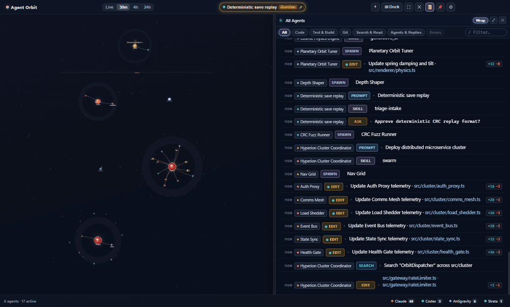
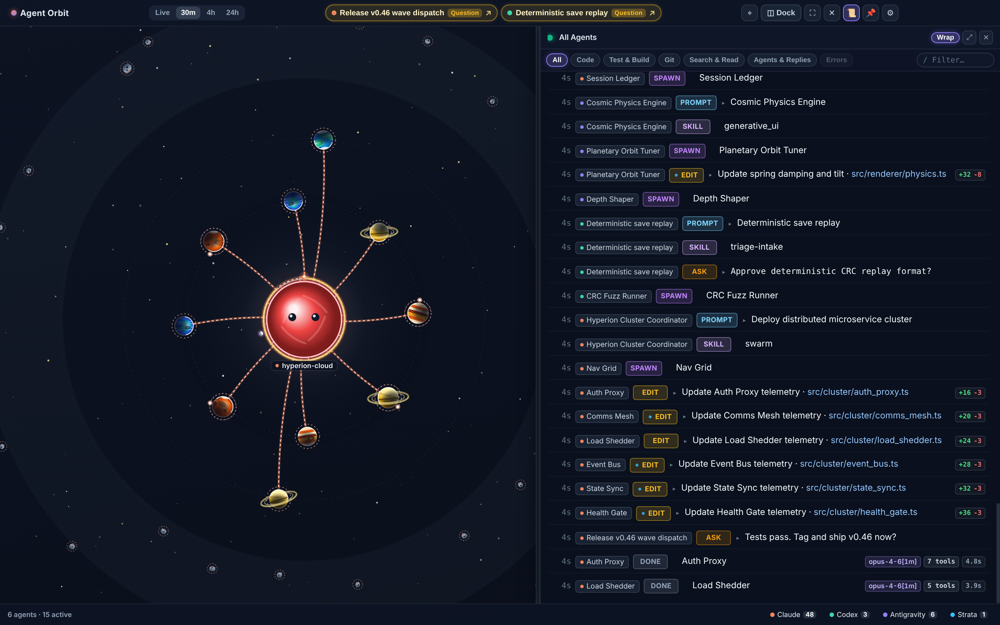

# Agent Orbit

See all your coding agents at a glance as live visual solar systems, with zero token cost and minimal system overhead.



## Features

- **See Agents & Subagents Visually** — Each active session appears as a star with live orbiting subagents, an outer belt of completed subagents, and a context-window fuel ring.
- **Spot Agents Waiting on You** — Sessions waiting on your input rise into an **Awaiting You** spotlight lane so you can jump straight to them.
- **Zero Token & Low System Overhead** — Passively reads local transcripts on disk with lightweight 2D rendering, never injecting prompts, hooks, or MCP servers.
- **Live Activity Log & Edge Dock** — Search prompts, tool calls, and diffs in real time, or collapse the app into a tiny screen-edge capsule while you work.



## Quick Start

Requires Windows 10/11 and Node.js 20+.

```bash
git clone https://github.com/LGTM-Probably/agent-orbit.git
cd agent-orbit
npm install
npm start
```

## Shortcuts

- **Canvas:** Drag to pan, scroll to zoom, and click a star to filter the activity log.
- **Focus Agent (`Alt+Shift+Space`):** Jump straight to the window of an agent waiting on your input, or double-click any star.
- **Summon (`Alt+Shift+O`):** Show or minimize Agent Orbit from anywhere.
- **Search (`/` or `Ctrl+F`):** Filter the live activity log instantly.

## Documentation

- **[User Guide & Visual Mechanics](docs/guide.md)** — Supported agents, stellar mechanics, dock mode, full controls, and build scripts.
- **[Architecture & Internals](docs/architecture.md)** — Incremental log tailing, delta IPC protocol, orbital physics, and procedural 2D rendering.
- **[Adding a New Agent Provider](docs/adding-a-provider.md)** — Step-by-step guide to supporting another coding agent's transcript format.

## License

Released under the [MIT License](LICENSE).
