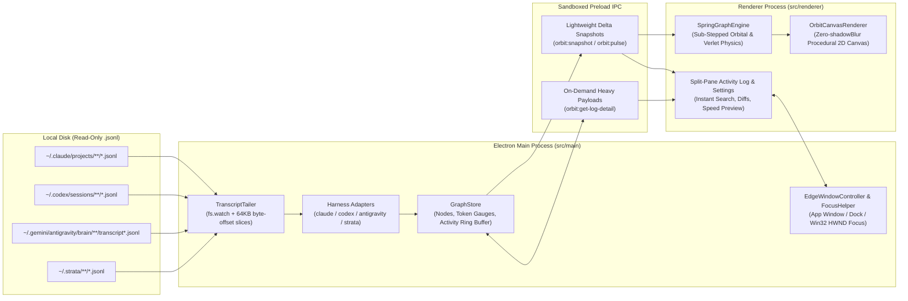

# How It Works & Architecture

[← Back to README](../README.md)

Agent Orbit is split into a read-only **Electron Main** telemetry pipeline and a zero-allocation-minded **HTML5 2D Canvas + Virtualized Log Renderer** connected over a sandboxed `contextBridge` IPC channel.

---

## Key Design Choices

1. **Incremental Byte-Offset Tailing (`src/main/tailer.ts`):**
   - On startup, `TranscriptTailer` scans candidate directories with an `mtime` cutoff (`25h`), immediately hydrates up to 12 hot sessions (`<= 45m`) within a 16ms frame budget, and streams older transcripts in 8ms background slices (`256 KB` chunks via reusable `Buffer` + `StringDecoder`) so the UI opens instantaneously even with gigabytes of historical logs.
   - Fast string pre-filters skip multi-megabyte request/snapshot blobs *before* `JSON.parse`.
2. **Two-Tier Memory & Wire Protocol (`src/main/graphStore.ts`):**
   - `GraphStore` normalizes adapter events into `MutableAgentNode` states (tracking streaming message deduplication, compaction resets, blocking user-question tools, turn counts, and parent-child subagent trees) and a monotonically sequenced `ActivityLogEntry` ring buffer.
   - Periodic snapshots (`orbit:snapshot`) strip heavy fields (`fullText`, `output`, `diffPreview`, `toolInput`) and transmit only new/changed log entries (`sinceLogSeq` delta mode). Full multi-line diffs, prompts, and terminal outputs are fetched in `O(1)` via `orbit:get-log-detail` only when you click to expand a row.
3. **Sub-Stepped Keplerian + Spring Physics (`src/renderer/physics.ts`):**
   - Root orchestrators arrange into non-overlapping constellation anchors (with `waiting_on_user` stars promoted into the top **Awaiting You** spotlight lane).
   - Active subagents ride concentric Keplerian planetary rings (`omega ~ r^-1.5`), while completed subagents transition through a multi-second `SpiralReentryState` out into a Golden-Angle-seeded Kuiper Asteroid Belt (`computeAsteroidFieldBand`), sub-stepped so high animation speeds (`up to 3.0×`) remain numerically stable across 60Hz–240Hz displays.
4. **Zero-`shadowBlur` Procedural Rendering (`src/renderer/canvasRenderer.ts`):**
   - Every star corona, prominence flare, exoplanet atmosphere, ring system, Core Fuel gauge, and asteroid silhouette is drawn with layered radial gradients and alpha geometry — **strictly zero `ctx.shadowBlur` calls** (enforced by automated unit tests) to maintain locked high-refresh frame times on 4K/ultrawide monitors.
5. **Local-Only Security Posture (`src/main/main.ts`, `src/renderer/index.html`):**
   - Runs with `contextIsolation: true`, `nodeIntegration: false`, `sandbox: true`, navigation/popup blocking, strict `default-src 'self'` CSP, and file-open extension guards (`shouldRevealInsteadOfExecute`) that reveal scripts/binaries in Explorer instead of executing them.

---

## Related Docs

- [User Guide & Visual Mechanics](guide.md)
- [Adding a New Agent Provider](adding-a-provider.md)
